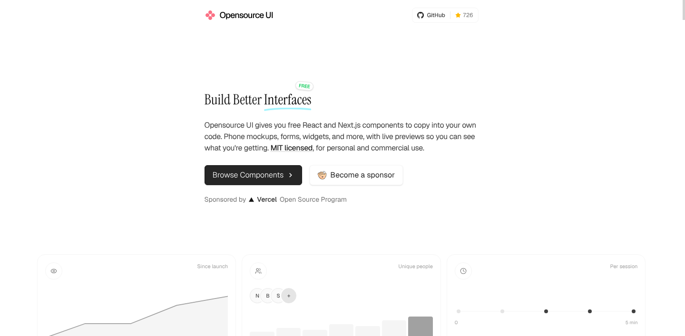

# Reverse engineering opensourceui.in

Target: https://opensourceui.in/ (captured 2026-10-12)
Tooling: [REA](https://github.com/morluto/rea) `rea-agents@6.4.0` CLI, run against headless Chromium 141 over CDP.

## Method

| Step | REA command | Result |
| --- | --- | --- |
| 1 | `rea list-browser-targets http://127.0.0.1:9222` | One page target on `https://opensourceui.in` |
| 2 | `rea inspect-web-page … --observation-ms 3000 --include-accessibility-text --include-storage-keys` | DOM/a11y tree, 28 resources, storage key names |
| 3 | `rea analyze-web-bundle … --fetch-source-maps` | 22 scripts parsed (491k AST nodes), routes, endpoints, vendor fingerprints |
| 4 | `rea capture-web-screenshot …` | Viewport PNG (above) |

Then each finding was checked against the source code the bundle pointed to.

## Findings

### 1. The site's own source code is public
Step 3 found a `fetch` call to `https://api.github.com/repos/bidyut10/opensourceui`. That repository is the site's source, MIT-licensed (© 2026 Bidyut Kundu). Three things confirm the live site is built from it:

- The deployed response headers (CSP, `X-Frame-Options: DENY`, `Permissions-Policy`, …) match `vercel.json` byte for byte.
- The `sessionStorage` keys REA saw (`osui:nav-stack`, `osui:nav-boot`) and the `localStorage` key `oui_vid` appear verbatim in `lib/navigation/path-memory.ts` and `lib/analytics/client/send-events.ts`.
- The `/sponsor` route and the `category` / `q` query params from the bundle match `app/(marketing)/sponsor` and the docs search.

So you don't need to rebuild it from minified chunks: the source is there to read and reuse under MIT.

### 2. Stack

| Layer | Evidence |
| --- | --- |
| Next.js 16 (App Router, Turbopack chunks), **static export** (`output: "export"`) | REA `next-runtime` fingerprint; `_next/static/chunks/*`; `next.config.ts` |
| React 19.3 | REA `react-runtime` fingerprint; `package.json` |
| Tailwind CSS v4 + `clsx` + `tailwind-merge` (`lib/cn.ts`) | Tailwind class strings flagged as "routes" in the bundle |
| Fonts: Geist, Geist Mono, Instrument Serif (`next/font`) | `<html>` class names, 3 preloaded woff2 files |
| Icons: `lucide-react` | `package.json` |
| Hosting: Vercel (`server: Vercel`, `x-vercel-cache: HIT`); Cloudflare Workers config also in the repo | Response headers, `wrangler.toml` |
| Analytics: PostHog (`ph_phc_…` storage keys, `/ingest` rewrite) | Storage capture, `vercel.json` |
| Errors and replay: Sentry (`sentry-trace`, `baggage`, `sentryReplaySession`) | Bundle endpoints, storage capture |

### 3. How it works

- **Component catalog = one registry file.** `lib/showcase/showcase.tsx` (~3.2k lines) defines every component with a helper `c(slug, <Preview/>, "components/…/file.tsx", exportName, opts)`, about 218 entries grouped into rows and categories. The `/components/[slug]` pages are pre-rendered with `generateStaticParams`.
- **"Copy-paste" code comes from the real source at build time.** `lib/showcase/server.ts` reads the component's `.tsx` file plus `lib/cn.ts` from disk, and `highlight-code.tsx` syntax-highlights it. The code you copy is the same file that renders the live preview, so the two can't drift apart.
- **Back button with its own history.** `path-memory.ts` keeps a 24-entry stack in `sessionStorage` and seeds it from `document.referrer` and `PerformanceNavigationTiming`, so "Go back" stays inside the site.
- **GitHub star badge** fetches `stargazers_count` from the GitHub API in the browser on every load, with no caching. The CSP allows `connect-src https://api.github.com` for this.
- **Homepage stat cards are hard-coded.** "500K+ page views / 70K+ visitors / 4 min" come from `siteConfig.stats` in `lib/site.ts`. The sparkline, avatars and bars are decorative SVG and Tailwind; nothing is fetched live.
- **Visitor ID:** a random UUID kept in `localStorage.oui_vid` is passed to PostHog `identify`. Page views are debounced to one per 800 ms per path.

### 4. Security posture
The CSP is strict: `default-src 'self'`, `frame-ancestors 'none'`, `object-src 'none'`, with only PostHog, Sentry and GitHub allowed. `script-src` still includes `'unsafe-inline'`, which Next.js inline bootstrapping requires. Static `_next/static` assets are served `immutable` for one year.

## Limits
- No source maps are deployed, so REA's source-map recovery came back `unavailable`. The public repo makes up for that.
- Network capture started after page load (`prior_activity_available: false`), so requests made during the first load aren't listed. The endpoints above come from static bundle analysis.
- Only the homepage was captured; `/components/*` pages were analyzed from source.

## Reusing it
The components are MIT-licensed. Copy them from the repo (or the site's copy button) and keep the license notice. Components rely on `lib/cn.ts` (`clsx` + `tailwind-merge`) and Tailwind v4.
